<table>
  <tr>
    <td width="170" valign="top">
      
    </td>
    <td valign="top">

### Hi, I'm KJ

Graduate Research Assistant and PhD researcher in **Biosystems & Agricultural Engineering** at **Oklahoma State University**, part of the **RISE Lab** (Research in Irrigation Scheduling and Engineering) led by [Dr. Sumon Datta](https://experts.okstate.edu/sumon.datta).
I bridge **irrigation, agriculture and technology**, using machine learning and software development to build decision support tools that help growers decide *when* and *how much* to irrigate.

  </td>
  </tr>
</table>

---

### How I approach irrigation decisions

| **Sense** | **Forecast** | **Model** | **Decide** |
| :-- | :-- | :-- | :-- |
| Soil moisture probes, rain gauges, canopy temperature sensors and flux towers in Oklahoma fields | NOAA NDFD weather forecasts and satellite data | Machine learning and FAO-56 water-balance models | A web tool that recommends when and how much to irrigate |

### What I'm working on

- 🌱 **[OASIS](https://yeshwanthkj.github.io/#oasis): Operational Agriculture and Soil Information System.** A full-stack irrigation decision support platform (React · FastAPI · Plotly · Docker) that turns soil, weather and crop data into irrigation recommendations.
- 💧 **[Multi-depth soil moisture prediction](https://yeshwanthkj.github.io/#soil-moisture-ml).** Comparing Random Forest, LightGBM, XGBoost, LSTM and Transformer models, with lag features for fully autoregressive prediction.
- ☁️ **[NOAA NDFD forecast pipeline](https://yeshwanthkj.github.io/#ndfd-pipeline).** GRIB2 → daily, time-zone-aligned agronomic variables across Mesonet stations.
- 🛰️ **In progress:** OpenET root-zone depletion evaluation · historical irrigation water requirements (Lugert-Altus) · OASIS Kansas–Texas expansion · explainable AI for irrigation recommendations.

### Skills

**Irrigation science**&nbsp;

**Machine learning**&nbsp;

**Software development**&nbsp;

**Data, weather & geospatial**&nbsp;

**Field instrumentation**&nbsp;

### Recent publications & talks

- **Data-Driven Modeling of Soil Moisture in Irrigated Fields.** IEEE DCAS 2026 · [DOI](https://doi.org/10.1109/DCAS69364.2026.11544580)
- **Canopy Temperature Sensor Data Optimization for Irrigation Scheduling.** IEEE DCAS 2026 · [DOI](https://doi.org/10.1109/DCAS69364.2026.11545108)
- **Data-Driven Modeling of Multi-Depth Soil Moisture in Irrigated Fields.** ASABE Annual International Meeting 2026 (oral)
- **Data-Driven Modeling of Soil Moisture for Irrigation Scheduling.** Oklahoma Governor's Water Conference 2025 (oral)
- **Oklahoma Agricultural Scientific Irrigation Scheduler.** Oklahoma Governor's Water Conference 2024 (poster)

→ [Full list on my website](https://yeshwanthkj.github.io/#publications)

---

Irrigation • Agriculture • Technology · Stillwater, Oklahoma

